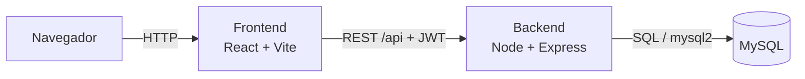
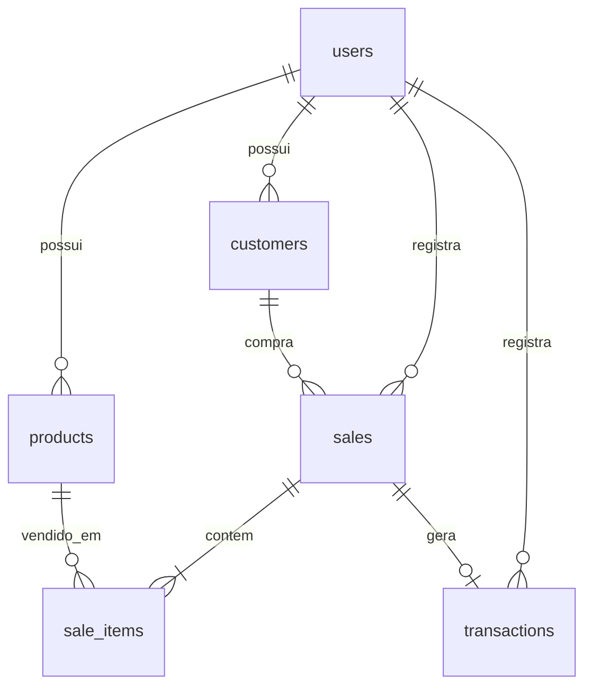

<h1 align="center">Controlai</h1>
<p align="center"><strong>Do caos ao controle.</strong><br/>Estoque, vendas e finanças de pequenos negócios em um único painel.</p>

<p align="center">
  
  
  
  
  
  
</p>

<!-- Coloque seus prints em docs/ e descomente:
<p align="center"></p>
-->

## Sobre o projeto

Muitos pequenos negócios (lojas, salões, lanchonetes, oficinas) ainda controlam tudo em caderno, planilha e WhatsApp. O resultado: informação espalhada, pouca visibilidade sobre o caixa e erros de conta.

O **Controlai** reúne **estoque, vendas e finanças** em um único sistema web. Ao registrar uma venda, o estoque baixa sozinho e a entrada cai no caixa. Se a venda for cancelada, tudo volta ao que era antes.

É um projeto **full stack**: interface em React, API REST em Node.js e banco de dados MySQL.

## Funcionalidades

| Módulo | O que faz |
| --- | --- |
| **Autenticação** | Cadastro e login com senha criptografada e sessão por token JWT. Cada conta é um negócio com dados isolados. |
| **Visão geral** | Vendas de hoje e dos últimos 7 dias (com comparação), ticket médio, saldo do mês, gráfico de vendas e alertas de estoque. |
| **Vendas** | Carrinho com busca de produtos, cliente opcional, desconto e forma de pagamento (Pix, dinheiro, cartão). Cancelamento devolve o estoque e remove a entrada do caixa. |
| **Estoque** | Cadastro, edição e exclusão de produtos, busca e filtros. Status automático: em estoque, baixo, crítico ou esgotado. |
| **Financeiro** | Entradas e saídas, saldo do mês, gráfico dos últimos 6 meses, despesas por categoria e lançamentos manuais. |
| **Clientes** | Cadastro com total gasto, número de pedidos e última compra. Classificação: ativo, recorrente ou inativo. |
| **Relatórios** | Vendas por categoria, produtos mais vendidos e formas de pagamento, em períodos de 7, 30 ou 90 dias. |
| **Assistente** | Recomendações geradas dos dados reais (estoque baixo, queda nas vendas, melhor dia da semana, clientes para reconquistar). Usa regras simples, não IA generativa. |

A interface é responsiva e funciona bem no celular.

## Arquitetura



- **Frontend** (`frontend/`): SPA com React Router, gráficos com Recharts e estilo com Tailwind CSS.
- **Backend** (`backend/`): API REST em Express com validação (Zod), autenticação JWT e consultas SQL diretas.
- **Banco** (`backend/sql/schema.sql`): MySQL com chaves estrangeiras, restrições de integridade e índices.

### Modelo de dados



Regras principais de negócio:

- **Venda atômica:** criar a venda, os itens, baixar o estoque e lançar a entrada no caixa acontecem em **uma única transação**. Se qualquer passo falhar, nada é gravado.
- **Sem estoque negativo:** os produtos da venda são travados (`SELECT … FOR UPDATE`) durante a transação, então duas vendas simultâneas não vendem o mesmo estoque duas vezes.
- **Histórico preservado:** a venda guarda nome e preço do produto no momento da compra. Excluir um produto é exclusão lógica.
- **Status do estoque:** `esgotado` (0), `crítico` (≤ metade do mínimo), `baixo` (< mínimo), `ok`.
- **Isolamento:** toda consulta filtra pelo usuário logado. Um negócio nunca enxerga dados de outro.

## Tecnologias

| Camada | Tecnologias |
| --- | --- |
| Frontend | React 19, TypeScript, Vite, React Router, Tailwind CSS 4, Recharts, Lucide |
| Backend | Node.js 22, Express 5, TypeScript, mysql2, Zod, JSON Web Token, bcryptjs, Helmet, CORS, express-rate-limit |
| Banco | MySQL 8 (testado também com MariaDB 10.11) |
| Testes | Vitest e Supertest |

## Como rodar

### Requisitos

- [Node.js 22](https://nodejs.org) ou superior
- MySQL 8: com [Docker](https://www.docker.com) (recomendado) ou instalado na máquina

### 1. Clonar e instalar

```bash
git clone https://github.com/Igor2110/ControlAI.git
cd ControlAI
npm install          # instala o executor dos dois servidores
npm run setup        # instala backend e frontend
```

### 2. Banco de dados

**Com Docker:**

```bash
docker compose up -d
```

**Sem Docker:** crie o banco e o usuário no seu MySQL:

```sql
CREATE DATABASE controlai CHARACTER SET utf8mb4;
CREATE USER 'controlai'@'localhost' IDENTIFIED BY 'controlai';
GRANT ALL ON controlai.* TO 'controlai'@'localhost';
```

### 3. Configurar o ambiente

```bash
cp backend/.env.example backend/.env
```

Os valores padrão já funcionam com o `docker-compose.yml`. Em produção, troque o `JWT_SECRET`.

### 4. Criar as tabelas e os dados de exemplo

```bash
npm run db:setup
```

Isso cria as tabelas e uma **conta de demonstração** com cerca de 4 meses de vendas fictícias:

| E-mail | Senha |
| --- | --- |
| `demo@controlai.com` | `demo1234` |

Para criar só as tabelas, sem dados de exemplo: `npm run db:migrate`.

### 5. Iniciar

```bash
npm run dev
```

- Frontend: http://localhost:5173
- API: http://localhost:3333/api (teste em `/api/health`)

Na tela de login há o botão **Entrar com a conta de demonstração**.

## Variáveis de ambiente

Arquivo `backend/.env`:

| Variável | Padrão | Descrição |
| --- | --- | --- |
| `PORT` | `3333` | Porta da API |
| `CORS_ORIGIN` | `http://localhost:5173` | Origens permitidas (separe várias por vírgula) |
| `DB_HOST` / `DB_PORT` | `localhost` / `3306` | Endereço do MySQL |
| `DB_USER` / `DB_PASSWORD` | `controlai` / `controlai` | Credenciais do banco |
| `DB_NAME` | `controlai` | Nome do banco |
| `JWT_SECRET` | (obrigatório) | Segredo para assinar os tokens. Use um valor longo e aleatório |
| `JWT_EXPIRES_IN` | `7d` | Validade do token |

No frontend, `VITE_API_URL` define a URL da API em produção. Em desenvolvimento o Vite redireciona `/api` para o backend.

## Scripts

Na raiz do projeto:

| Comando | Descrição |
| --- | --- |
| `npm run dev` | Backend e frontend juntos |
| `npm run db:setup` | Cria as tabelas e os dados de exemplo |
| `npm run db:migrate` | Só cria as tabelas |
| `npm run db:seed` | Recria os dados de demonstração |
| `npm test` | Testes de integração do backend (o banco precisa estar no ar) |
| `npm run build` | Build de produção do backend e do frontend |

## API

Todas as rotas ficam sob `/api`. Exceto login e cadastro, exigem o cabeçalho `Authorization: Bearer <token>`.

| Método | Rota | Descrição |
| --- | --- | --- |
| `POST` | `/auth/register` | Cria conta e retorna o token |
| `POST` | `/auth/login` | Autentica e retorna o token |
| `GET` `PUT` | `/auth/me` | Dados da conta e edição |
| `GET` | `/dashboard` | KPIs, séries de vendas, alertas e últimas vendas |
| `GET` `POST` | `/products` | Lista (filtros `q`, `category`, `status`) e cria |
| `GET` `PUT` `DELETE` | `/products/:id` | Consulta, edita e exclui (lógica) |
| `GET` | `/products/categories` | Categorias existentes |
| `GET` `POST` | `/customers` | Lista (filtro `q`) e cria |
| `GET` `PUT` `DELETE` | `/customers/:id` | Consulta, edita e exclui |
| `GET` `POST` | `/sales` | Lista (filtros `status`, `from`, `to`, `limit`, `offset`) e registra venda |
| `GET` | `/sales/:id` | Venda com itens |
| `POST` | `/sales/:id/cancel` | Cancela, devolve estoque e remove a entrada do caixa |
| `GET` `POST` | `/finance/transactions` | Lista (filtros `type`, `from`, `to`) e cria lançamento |
| `DELETE` | `/finance/transactions/:id` | Remove lançamento manual |
| `GET` | `/finance/summary` | Resumo do mês, histórico mensal e despesas por categoria |
| `GET` | `/reports/by-category` `top-products` `by-payment` | Relatórios por período (`from`, `to`) |
| `GET` | `/insights` | Recomendações do assistente |
| `GET` | `/health` | Verificação do servidor e do banco |

Exemplo de venda:

```http
POST /api/sales
{
  "customerId": 1,
  "paymentMethod": "pix",
  "discount": 5,
  "items": [{ "productId": 3, "quantity": 2 }]
}
```

Erros seguem o formato `{ "error": "mensagem" }`, com `details` quando a validação falha. Códigos usados: `400` dados inválidos, `401` sem login, `404` não encontrado, `409` conflito (por exemplo, estoque insuficiente).

## Segurança

- Senhas com hash **bcrypt**; nunca são armazenadas ou retornadas em texto.
- Autenticação por **JWT** com expiração.
- Toda entrada é validada com **Zod**; as consultas SQL usam parâmetros (sem concatenar texto do usuário).
- **Helmet** (cabeçalhos HTTP), **CORS** restrito e limite de tentativas nas rotas de login e cadastro.
- Dados isolados por usuário em todas as consultas.

## Testes

```bash
npm test
```

São 9 testes de integração que sobem a API e usam o banco de verdade: cadastro e login, rotas protegidas, validação de produto, venda com baixa de estoque e lançamento no caixa, recusa por estoque insuficiente, cancelamento e isolamento entre negócios.

## Estrutura do projeto

```
controlai/
├── backend/
│   ├── sql/schema.sql         # tabelas, chaves e restrições
│   ├── src/
│   │   ├── app.ts             # monta o Express
│   │   ├── server.ts          # inicia o servidor
│   │   ├── config.ts          # variáveis de ambiente validadas
│   │   ├── db/                # pool MySQL, migração e seed
│   │   ├── middleware/        # autenticação e tratamento de erros
│   │   ├── routes/            # um arquivo por módulo
│   │   └── lib/               # datas, erros e utilidades
│   └── tests/                 # testes de integração
├── frontend/
│   └── src/
│       ├── pages/             # uma página por tela
│       ├── components/        # layout e componentes de UI
│       ├── context/           # autenticação
│       └── lib/               # cliente da API, tipos e formatação
├── docker-compose.yml         # MySQL para desenvolvimento
└── docs/                      # prints do sistema
```

## Publicação (deploy)

1. **Banco:** crie um MySQL gerenciado e rode `npm run db:migrate` apontando para ele.
2. **Backend:** `npm run build` e `npm start` (dentro de `backend/`), com as variáveis de ambiente configuradas e `CORS_ORIGIN` apontando para o endereço do frontend.
3. **Frontend:** `npm run build` (dentro de `frontend/`), com `VITE_API_URL` apontando para a API. A pasta `dist/` pode ser publicada em qualquer hospedagem estática. Configure o redirecionamento de todas as rotas para `index.html`, pois é uma SPA.

Em produção, **não rode o seed** (a conta de demonstração tem senha pública).

## Limitações e próximos passos

- [ ] Recuperação de senha e confirmação de e-mail
- [ ] Mais de um usuário por negócio, com perfis de acesso
- [ ] Emissão de nota fiscal e integração com meios de pagamento
- [ ] Controle de fornecedores e compras
- [ ] Exportar relatórios em PDF/CSV
- [ ] Testes do frontend e pipeline de CI

## Autor

Feito por **Igor** ([@Igor2110](https://github.com/Igor2110)) no curso técnico de Informática para Internet do Senac.
